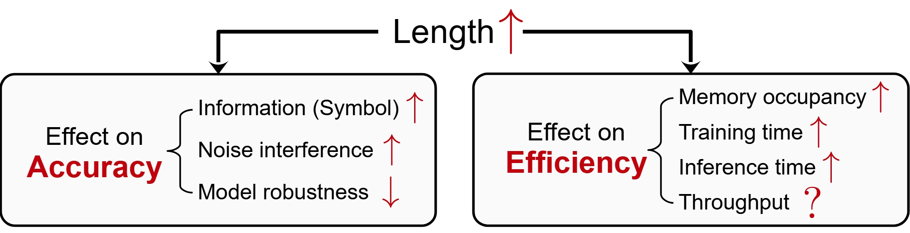
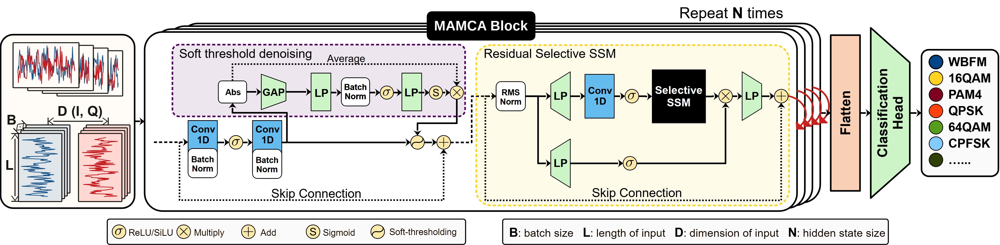

# MAMC
A method for Automatic Modulation Classification using [Mamba](https://github.com/state-spaces/mamba) structure

A project employing the **Selective State Space Model (Mamba)** method for **Automatic Modulation Classification (AMC)** in a scenario of **extended signal length**.

The increased sequence length complicates the learning process and diminishes accuracy, while simultaneously escalating memories and reduces timeliness. This issue brings the following impacts:



if our codes helped your reasearch, please consider citing the corresponding submission

## arXiv
> @article{zhang2024MAMC,<br>
> &emsp;&emsp;title={MAMCA -- Optimal on Accuracy and Efficiency for Automatic Modulation Classification with Extended Signal Length},<br>
> &emsp;&emsp;author={Yezhuo Zhang and Zinan Zhou and Yichao Cao and Guangyu Li and Xuanpeng Li},<br>
> &emsp;&emsp;year={2024},<br>
> &emsp;&emsp;journal={arXiv preprint arXiv:2405.11263},<br>
> }
## IEEE Communications Letters (Early Access)
[MAMC](https://ieeexplore.ieee.org/document/10705364)
> @article{10705364,<br>
> &emsp;&emsp;author={Zhang, Yezhuo and Zhou, Zinan and Cao, Yichao and Li, Guangyu and Li, Xuanpeng},<br>
> &emsp;&emsp;journal={IEEE Communications Letters}, <br>
> &emsp;&emsp;title={MAMC - Optimal on Accuracy and Efficiency for Automatic Modulation Classification with Extended Signal Length}, <br>
> &emsp;&emsp;year={2024},<br>
> &emsp;&emsp;volume={},<br>
> &emsp;&emsp;number={},<br>
> &emsp;&emsp;pages={1-1},<br>
> &emsp;&emsp;doi={10.1109/LCOMM.2024.3474519}<br>
> }

We utilize a denosing unit for better accuracy performance under **noise interference**, while using Mamba as the backbone for **low GPU occupancy** and **training/inference time**.
- MAMC structure


To related AMC works, as well as sorce code: 
- Deep Learning Based Automatic Modulation Recognition: Models, Datasets, and Challenges

    [AMR-Benchmark](https://github.com/Richardzhangxx/AMR-Benchmark?tab=readme-ov-file)

To the denosing method employed in our work, as well as source code: 
- IEEE Transactions on Industrial Informatics 2020

    [Deep Residual Shrinkage Networks for Fault Diagnosis](https://ieeexplore.ieee.org/abstract/document/8850096)

- Deep-Residual-Shrinkage-Networks-for-intelligent-fault-diagnosis-DRSN

    [pytorch-Deep-Residual-Shrinkage-Networks (DRSN)](https://github.com/liguge/Deep-Residual-Shrinkage-Networks-for-intelligent-fault-diagnosis-DRSN-)


To the Mamba method employed in our work, as well as source code: 
- arXiv preprint arXiv:2312.00752

    [Mamba: Linear-Time Sequence Modeling with Selective State Spaces](https://arxiv.org/abs/2312.00752)

- mamba

    [mamba](https://github.com/state-spaces/mamba)

## MAMC2

As a supplement to the original MAMC, we provide **MAMC2**, combining lightweight
modules adapted from **CSPMNet** with **Mamba2** blocks for long-sequence AMC.
The original MAMC model remains available for comparison.

- **CSPMNet modules:** trainable, Morlet-initialized complex subband filters and
  multi-lag phase-motion features replace the original DRSN denoising front end.
  A small projection, depthwise local convolution and I/Q residual connection
  mix these features. The full reference implementation is retained in
  [CSPMNet.py](CSPMNet.py).
- **Mamba2 modules:** residual Mamba2 blocks model temporal dependencies through
  the official `mamba_ssm.Mamba2` library. A local PyTorch SSD implementation is
  also provided for understanding the model logic, customization and CPU use.
- **Classification head:** mean pooling and single-score temporal attention
  replace the length-dependent flattening head, allowing the same model to
  accept different signal lengths.

```text
I/Q input -> CSPMNet subband / phase-motion features -> local feature mixer
          -> residual Mamba2 blocks -> temporal pooling -> modulation logits
```

Two configurations are available with 11 classes and width 32:

| Configuration | Mamba2 blocks | Front-end stride | Parameters |
|---|---:|---:|---:|
| MAMC2 (default) | 2 | 1 | 21,608 |
| MAMC2 lightweight | 1 | 4 | 12,578 |

The lightweight configuration extracts phase-motion features at the original
sampling rate, then downsamples the features before local mixing and Mamba2.
Parameter counts are independent of input length. The local SSD backend uses
fixed-size chunks and a work-efficient affine prefix scan, with linear total
work in sequence length for fixed model dimensions and chunk size.

To the Mamba2 method employed in this extension, as well as source code:

- [Transformers are SSMs: Generalized Models and Efficient Algorithms Through Structured State Space Duality](https://arxiv.org/abs/2405.21060)
- [Mamba / Mamba2](https://github.com/state-spaces/mamba)

The implementation is organized in `mamc/csp.py`, `mamc/mamba2.py` and
`mamc/model.py`. The `torch` backend implements a restricted Mamba2 subset
with one B/C group and no incremental inference cache; it does not implement
all upstream options. Neither backend is selected as a silent fallback.

## Requirements

Run the following commands from the repository root. The tested configuration
uses Linux / Ubuntu (including WSL), Python 3.12, PyTorch 2.6.0 and CUDA 12.4.
The official Mamba2 backend requires a CUDA GPU. The repository provides one
[requirements.txt](requirements.txt) for training, benchmarking and tests.

Install PyTorch and build tools before installing the CUDA extensions:

```bash
conda create -n mamba python=3.12 -y
conda activate mamba
python -m pip install torch==2.6.0 --index-url https://download.pytorch.org/whl/cu124
python -m pip install 'setuptools>=68' wheel packaging ninja
python -m pip install -r requirements.txt --no-build-isolation
python scripts/check_mamba2.py --require-official
```

Use an existing environment by activating it and following the installation
steps from the PyTorch command onward. The pinned `mamba-ssm==2.2.6.post3` and
`causal-conv1d==1.5.2` versions are the tested Mamba2 configuration, rather than
a claim that these are the latest upstream releases.

On the tested RTX 2060, **official fused Mamba2 with float16 AMP** supports
forward and backward execution. The float32 fused path and the unfused path
encountered upstream kernel / stride-alignment errors with this small-width
configuration. Use `--amp` for the official backend on this setup, and run the
check script to verify other hardware. Parameters remain in float32; the
training script applies autocast and GradScaler. Validation and checkpoint
evaluation also honor `--amp`.

If a prebuilt extension fails to import with an `undefined symbol` error,
rebuild it against the active PyTorch installation. This requires a matching
CUDA Toolkit with `nvcc`; `CUDA_HOME` must point to a single toolkit directory:

```bash
export CUDA_HOME=/usr/local/cuda-12.4
export PATH="$CUDA_HOME/bin:$PATH"
python scripts/build_mamba_extensions.py --cuda-home "$CUDA_HOME"
python -m pip check
python scripts/check_mamba2.py --require-official
```

The build helper downloads the pinned source releases and verifies their
archive hashes. It changes only the build architecture and compiler job count,
leaving model and kernel sources intact. The resulting extensions target the
current GPU; rebuild them when moving to a different GPU architecture.

## Training

The shared training entry point supports MAMC2, the original MAMC model and the
CSPMNet reference model. Supply your own dataset path:

```bash
# Original MAMC (DRSN + Mamba1)
python scripts/train.py --model legacy --device cuda \
  --data /path/to/RML2016.10a_dict.pkl \
  --epochs 40 --batch-size 256 --seed 42 --output outputs/mamc

# MAMC2: official Mamba2 + CSPMNet modules
python scripts/train.py --backend official --device cuda --amp \
  --data /path/to/RML2016.10a_dict.pkl \
  --epochs 40 --batch-size 256 --seed 42 --output outputs/mamc2

# Lightweight MAMC2
python scripts/train.py --backend official --device cuda --amp --layers 1 --stride 4 \
  --data /path/to/RML2016.10a_dict.pkl \
  --epochs 40 --batch-size 256 --seed 42 --output outputs/mamc2-lite
```

Use `--model cspmnet` to train the full CSPMNet reference model. The historical
`code/script/RML2016.10a.py` filename now forwards to the shared trainer with
`--model legacy`, using the same command-line arguments. The shell launcher
trains MAMC2:

```bash
AMC_DATA=/path/to/RML2016.10a_dict.pkl bash code/script/RML2016.10a.sh
```

Data formats supported by `mamc/data.py`:

- RadioML2016 pickle dictionaries: `(modulation, SNR) -> (N, 2, L)`.
- NPZ files: `X`, `Y`, and optional `SNR` and `classes` arrays.
- HDF5 files: `X`, `Y`, and optional `SNR` or `Z` arrays.

For NPZ / HDF5, `X` may have shape `(N, 2, L)` or `(N, L, 2)`; `Y` contains
class indices starting from zero or one-hot labels. Training uses a fixed
60% / 20% / 20% split within each class/SNR group and selects checkpoints using
validation accuracy. Checkpoints, split indices, per-SNR accuracy and confusion
matrices are written to the chosen output directory. Use a new directory for
each training run. No datasets or pretrained checkpoints are bundled.

To evaluate a trained MAMC2 checkpoint on its saved held-out split, supply the
same dataset:

```bash
python scripts/train.py --backend official --device cuda --amp \
  --data /path/to/RML2016.10a_dict.pkl \
  --checkpoint outputs/mamc2/best.pt --output outputs/mamc2-eval
```

## Using MAMC2

```python
import torch
from mamc import MAMC2, MAMC2Config

model = MAMC2(MAMC2Config(num_classes=11)).cuda().eval()
x = torch.randn(2, 2, 1024, device="cuda")
with torch.inference_mode(), torch.autocast("cuda", dtype=torch.float16):
    logits = model(x)  # (2, 11)
```

For the lightweight configuration, set `n_layer=1, stride=4` in
`MAMC2Config`. For CPU execution or local SSD customization, select
`backend="torch"` and keep the model and input on CPU. The training equivalent
is `--backend torch --device cpu`. The portable backend uses PyTorch operations
and its timing should be reported separately from the official fused backend.

## Benchmarking and Tests

Measure random I/Q inputs from 128 to 4096 points:

```bash
python scripts/benchmark.py --backend official --amp \
  --lengths 128 256 512 1024 2048 4096 --output outputs/benchmark.json
python scripts/benchmark.py --backend official --amp --training --batch-size 2 \
  --output outputs/benchmark-training.json
python -m pytest -q -p no:cacheprovider
```

Add `--layers 1 --stride 4` to benchmark the lightweight configuration, or
`--model legacy` for the original MAMC. Training-mode comparisons use batch
size 2 or larger because the original DRSN contains batch normalization after
pooling. Measurements include synchronized forward execution, or forward and
backward with `--training`, and exclude data transfer and optimizer steps.
Peak allocated memory is measured by PyTorch.

RadioML2016.10a provides 128-point samples. Random long inputs validate runtime
and memory costs; long-sequence classification accuracy requires real long
observations. The tests cover SSD recurrence and gradient consistency,
CSPMNet feature equivalence, variable-length inputs and checkpoint loading.

## Contact

If you have any problem with our code or any suggestions, including discussion on SEI, please feel free to contact

- Yezhuo Zhang (zhang_yezhuo@seu.edu.cn | zhang_yezhuo@outlook.com)
- Zinan Zhou (zhouzinan919@seu.edu.cn)
- Xuanpeng Li (li_xuanpeng@seu.edu.cn)

